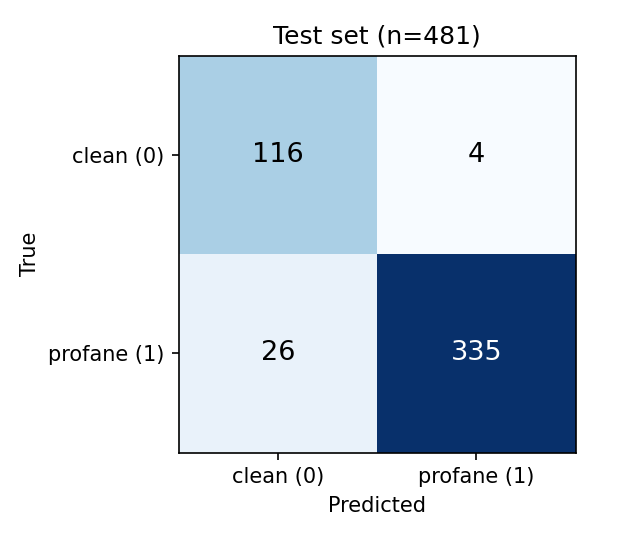

# kz-profanity-detection-DL26
A trained model that reads a Kazakh product review or comment about goods and predicts whether it contains Kazakh profanity

DSSC5113 Deep Learning, Fall 2026

## Task

Input: one comment. Output: **0** (clean) or **1** (contains Kazakh profanity), plus a probability:
```python
predict(bundle, "Сапасы өте нашар")   # {'label': 0, 'probability': 0.01}
```

## Data

The reviews come from [KazSAnDRA](https://github.com/IS2AI/KazSAnDRA) (ISSAI), a public dataset of real Kazakh reviews from app stores, marketplaces, maps and book stores ([paper](https://arxiv.org/abs/2403.19335), license: <fill in>).

KazSAnDRA is labeled for sentiment, not profanity, so all its files were combined into one pool of **166,577 reviews**, and profanity labels were made from scratch:

1. **Normalize** the text, so that spelling variants look the same (қ→к, ү→у, repeated letters collapsed, Latin → Cyrillic).
2. **Search** with a list of Kazakh and Russian profane roots, plus masks like `с**а`. Matches are only candidates.
3. **Label by hand:** all 2,455 candidates, 600 rude-but-clean reviews (жаман, ешек, мал…), and 300 random reviews.
4. **Add** 2,700 more random reviews as clean. Only 1 of the 300 checked random reviews had missed profanity, so these are almost certainly clean. They are used for training only, never for testing.

**Result:** 6,055 comments, of which **2,457 are profane** and **3,598 are clean**.
Phone numbers, emails and usernames were replaced with tags.

Two things stood out:
- Almost all profanity is in **app-store** reviews; marketplace reviews have almost none.
- About **half of the profane reviews are positive**, so profanity is not the same as a bad review.

**Splits:** 70 / 15 / 15, seed 42. Each split keeps the same share of profane comments, near-duplicates stay in the same split, and the test set contains only hand-checked rows.

| | Clean | Profane |
|---|---|---|
| Train | <> | <> |
| Validation | <> | <> |
| Test | <> | <> |

## Labeling rules

A comment is **1** if it contains an obscene or vulgar word, in any spelling.

- Negative or angry review without swear words → **0**
- Mild insults (мал, ешек, ақымақ, тупой) → **0**
- Russian swear words in a Kazakh comment → **1** (very common in Kazakh speech)
- Masked words (`с**а`) → **1** if the hidden word is clear
- Misspelled, Latin or joined-together forms → same as the normal word
- Codes and abbreviations (шшс, 667) → **1**
- боқ, говно → **1**; көтен (child's word, common in diaper reviews) → **0**
- Talking about swearing ("боқ сөз айтпаңдар") or emoji only (🖕) → **0**

| Comment (masked) | Label |
|---|---|
| Реклама коп | 0 |
| Мал ойын тартпандар бауырлар | 0 |
| Баланың көтенін құрғақ ұстайды | 0 |
| Скотчпен қатты жабыстырып орап тастаған | 0 |
| Миллион доллар с**а | 1 |
| Жарнама жарнама Қ****бас | 1 |
| Рекламасын с*нейін шшс | 1 |

## Model

A **character-level CNN** trained from scratch in PyTorch.

Why characters: swear words are often misspelled, masked or written in Latin letters. A model that reads letter by letter still recognizes parts of them, and it is small enough to train on a laptop in a few minutes.

How it works:
1. Normalize the text, with the same function for training and prediction.
2. Turn each character into a number. Rare characters become `<unk>`.
3. Cut or pad every comment to 300 characters, which covers about 98% of comments.
4. The CNN (kernel sizes 3/4/5) outputs a probability. Above the threshold → profane.

Settings: Adam, learning rate 0.001, batch 64, up to 30 epochs with early stopping, class weights for balance, seed 42. The threshold (<>) was chosen on the validation set.

## Experiments

On the validation set:

| Method | F1 |
|---|---|
| Keyword list only | <> |
| TF-IDF + logistic regression | <> |
| Char-CNN without normalization | <> |
| **Char-CNN (final)** | <> |

The keyword list scores high because the labels were found with it. Its real weakness is profanity that isn't on the list. <one sentence on the results>

## Results

Tested once on <N> hand-checked comments:

**Precision <>, Recall <>, F1 <>**



- **False positive:** a clean review is flagged and may be hidden unfairly.
- **False negative:** a swear word gets through and other users see it.

For moderation, missing profanity is usually worse; borderline cases can go to a human moderator.

## Mistakes the model made

1. "<comment>": predicted <>, should be <>. Why: <>
2. "<comment>": predicted <>, should be <>. Why: <>
3. "<comment>": predicted <>, should be <>. Why: <>

## How to run

Open any notebook from `notebooks/` in Google Colab; the first cell clones this repository. To run locally:
```bash
git clone https://github.com/<username>/kazakh-profanity-detection.git
cd kazakh-profanity-detection
pip install -r requirements.txt
```

1. `01_data_preparation.ipynb`: gets the data, finds candidates, builds `data/labeled.csv`
2. `02_split_and_train.ipynb`: splits, baselines, trains and saves the model
3. `03_evaluate_and_predict.ipynb`: tests once, shows errors, predicts new text

The trained model is in `model/`, so no retraining is needed:
```python
from src.predict import load_model, predict
bundle = load_model("model")
predict(bundle, "Керемет тауар, рахмет!")
```

## Limitations

- Profane examples were found with a word list, so unusual profanity is underrepresented.
- Almost no profane marketplace reviews, so product reviews are not well covered.
- The data is about 41% profane, but real reviews are about 1.5%, so real-world precision would be lower.
- One person labeled everything; borderline words could be judged differently by others.
- The model sees letters, not meaning, so it can't tell talking about swearing from swearing itself.
- Latin text is only partly handled (sh, zh, ş, ğ and mixed scripts).

Ideas for improvement: real marketplace comments, more annotators, a pretrained multilingual model, and human review of borderline cases.
